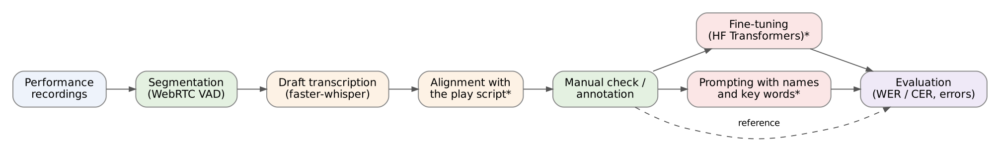

# This Whisper Is So Theatre

[Русская версия](README.ru.md)

Research on recognising Russian theatrical speech with Whisper models, towards live captions in theatre for deaf and hard-of-hearing audiences.



<sub>* Steps used in the thesis experiments; their code is not in this repository yet (see [Status](#status)).</sub>

## Research question

What does Whisper learn when it is fine-tuned on a recording of one theatre production, and can information from the play script (character names and key words) give part of that gain without any training?

## Key findings

Productions are referred to by codes (see [Corpus](#corpus)). WER is overall word error rate in %, computed on normalised lowercase text without punctuation. All numbers below come from the files in [`results/`](results).

**1. Fine-tuning helps on later scenes of the same production, not on other productions.** The decoder of `whisper-small` was fine-tuned on the first 70% of one recording and tested on the final 20% of the same recording and on other productions. Most of the gain comes from character names and plot vocabulary (error analysis; not included in `results/`).

| Test set | Segments | No fine-tuning | Fine-tuned on P3 | Fine-tuned on P4 |
| --- | ---: | ---: | ---: | ---: |
| P3, final 20% (unseen scenes) | 151 | 19.8 | **15.6** | 19.7 |
| P4, final 20% (unseen scenes) | 196 | 17.6 | 18.2 | **16.0** |
| P1 (other production) | 206 | 24.7 | 23.8 | 23.7 |
| P2 (other production) | 58 | 38.4 | 39.8 | 40.5 |

<sub>Source: [`results/finetune_matrix.csv`](results/finetune_matrix.csv) (also includes `whisper-tiny`, median per-segment WER and repetition loops). No confidence intervals were computed for this experiment yet.</sub>

**2. A prompt built from the play script helps on one production only.** `whisper-small` without fine-tuning received a prompt with character names and key words from the play script: its own play's ("own"), another play's ("foreign"), or no prompt. Difference own − none with a paired bootstrap (10,000 resamples, 95% CI, no correction for multiple comparisons):

| Test set | Segments | No prompt | Own prompt | Foreign prompt | Own − none, p.p. [95% CI] |
| --- | ---: | ---: | ---: | ---: | --- |
| P3, final 20% | 151 | 19.8 | **17.9** | 19.9 | **−1.87 [−3.11; −0.71]** |
| P4, final 20% | 196 | 17.6 | 18.5 | 18.3 | +0.88 [−0.86; 2.95] |
| P1 | 206 | 24.7 | 27.8 | 27.6 | +3.04 [−1.37; 9.55] |
| P2 | 57 | 30.7 | 39.4 | 39.1 | +8.70 [1.75; 17.51] |

- On P3 the own prompt recovers about 45% of the fine-tuning gain (1.87 of 4.2 points); the foreign prompt gives nothing.
- Character names recognised with the own prompt: P3 37% → 83%, P4 53% → 77%. Recognition of key words does not change.
- On P2, any prompt makes WER significantly worse.
- The P2 reference here is a manually corrected version (57 segments), so its baseline differs from the one in finding 1 (58 segments, automatic labels).

<sub>Source: [`results/prompt_results.csv`](results/prompt_results.csv), [`prompt_bootstrap.csv`](results/prompt_bootstrap.csv), [`prompt_names_summary.csv`](results/prompt_names_summary.csv), [`prompt_keywords.csv`](results/prompt_keywords.csv).</sub>

**3. Aligning ASR output with the play script gives better labels than raw ASR.** On P1, which has a full manual reference (4,742 words), labels produced by aligning Whisper large-v3 output with the play script reach 11.5% WER, compared with 18.3% for raw Whisper large-v3. This is how the other productions were labelled before manual checking.

<sub>Source: [`results/alignment_eval.csv`](results/alignment_eval.csv).</sub>

## Corpus

| Code | Genre | Test set used above | Status |
| --- | --- | --- | --- |
| P1 | verse drama | whole recording, 206 segments | annotated (full manual reference) |
| P2 | play with long pauses | whole recording, 57–58 segments | annotated |
| P3 | play about a reality show | final 20%, 151 segments | annotated |
| P4 | contemporary play | final 20%, 196 segments | annotated |
| P5 | — | — | annotation in progress |

## Status

**Done**
- Corpus of four annotated productions (P1–P4).
- Toolkit in this repository: dataset builder, draft transcription, evaluation app.
- Experiments behind findings 1–3.

**In progress**
- Annotation of P5.
- Paper *What Does Whisper Learn from One Performance?* for the EACL 2027 Student Research Workshop: draft in the pre-submission mentorship programme, final submission planned for December 2026. Not yet submitted or accepted.
- Cleaning up the thesis code (script alignment, fine-tuning matrix, prompt experiment) for release in this repository.
- Bachelor's thesis at HSE University, St Petersburg (defence in spring 2027).

**Planned**
- Pilot of live captions at Ostrov Theatre (St Petersburg), agreed with the theatre for April 2027.
- Perception study with deaf and hard-of-hearing audience members.

## Repository structure

```
this-whisper-is-so-theatre/
├── dataset_builder/        # GUI: audio extraction, VAD segmentation, manual annotation
│   ├── main.py             #   entry point
│   ├── segmenter.py        #   speech segment detection (WebRTC VAD)
│   ├── annotation_window.py
│   ├── clean_annotations.py#   CLI: remove empty annotations
│   └── ...
├── scripts/
│   ├── transcribe.py       # GUI: draft transcription of videos (faster-whisper)
│   ├── normalize_text.py   # GUI: text normalisation before comparison
│   └── merge_datasets.py   # GUI: merge annotation tables
├── evaluation/             # Streamlit app: WER/CER, error breakdown, hallucinations
├── notebooks/
│   └── coursework_finetune_whisper_tiny.ipynb  # course-paper fine-tuning (superseded protocol)
├── results/                # aggregated metrics behind the findings above
├── imgs/
├── requirements.txt
└── LICENSE
```

## Quickstart

Requires Python 3.11+ (tested with 3.13), [ffmpeg](https://ffmpeg.org/), Tk and PortAudio. On Debian/Ubuntu: `sudo apt install ffmpeg python3-tk libportaudio2`.

```bash
git clone https://github.com/jan-apakatapa/this-whisper-is-so-theatre.git
cd this-whisper-is-so-theatre
python -m venv .venv
source .venv/bin/activate        # Windows: .venv\Scripts\activate
pip install -r requirements.txt
```

All commands are run from the repository root.

1. **Build a dataset** from a recording (GUI). Extracts audio, detects speech segments and opens the annotation window; writes `annotations.csv` and `data/segments/`:
   ```bash
   python -m dataset_builder.main
   ```
2. **Draft transcription** of a folder of videos (GUI, optional). Writes `result.txt`; English fragments are translated with Google Translate via `deep-translator`, which sends that text to Google:
   ```bash
   python scripts/transcribe.py
   ```
3. **Remove empty annotations** (also deletes their audio files):
   ```bash
   python -m dataset_builder.clean_annotations annotations.csv
   ```
4. **Normalise texts** or **merge datasets** (GUI): `python scripts/normalize_text.py`, `python scripts/merge_datasets.py`.
5. **Evaluate** a reference against two transcriptions (labelled Whisper tiny and small in the interface):
   ```bash
   streamlit run evaluation/app.py
   ```
6. **Fine-tune** with [`notebooks/coursework_finetune_whisper_tiny.ipynb`](notebooks/coursework_finetune_whisper_tiny.ipynb) in Google Colab. This is the course-paper version with a random split; it does not reproduce the findings above.

## Data

**Published:** code, aggregated metrics in `results/` and a description of the corpus by genre.

**Not published:** audio and video recordings, segment-level transcripts, play texts, prompts built from the play texts and fine-tuned model weights. Rights to some of the recordings are not confirmed, and the play texts are under copyright. Productions are therefore referred to by codes, and per-segment outputs stay private. The `.gitignore` excludes these files.

## Note on AI assistance

Code in this repository and in the experiment notebooks was written with substantial help from AI coding assistants (GitHub Copilot, Claude, GPT-4.1). Experiment design, evaluation and error analysis are the author's.

## Citation and contact

A citation for the paper will be added once it is published. Until then, please cite this repository by its URL. Questions and comments are welcome via [GitHub issues](https://github.com/jan-apakatapa/this-whisper-is-so-theatre/issues).

**Author:** Eva Borodaenko  
**Supervisor:** Victoria Firsanova, Senior Lecturer, Department of Philology, HSE University

## License

Code: [MIT](LICENSE).
