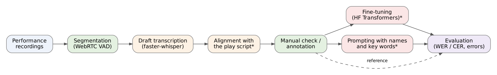

> Theatre ASR Toolkit — набор инструментов для исследования автоматического распознавания речи (Automatic Speech Recognition) в условиях театральной среды на основе моделей семейства [Whisper](https://arxiv.org/abs/2212.04356) от [OpenAI](https://openai.com/). Проект разработан в рамках курсового исследования по теме «Разработка системы автоматического текстового сопровождения театральных постановок на основе нейронных моделей распознавания речи» и направлен на повышение доступности театрального искусства для людей с нарушениями слуха.
>
> В отличие от типовых сценариев применения моделей распознавания речи, ориентированных на чистые студийные записи, театральная среда характеризуется фоновой музыкой, наложением реплик, эмоциональной окраской речи и нестабильной акустикой. Репозиторий объединяет инструменты, покрывающие полный цикл исследования: формирование размеченного набора данных на материале реальных постановок, черновую расшифровку записей, дообучение компактных моделей Whisper (`tiny`, `small`) и количественную оценку качества распознавания по метрикам WER и CER.

> Общая схема конвейера обработки данных показана ниже:
>
> 

## Overview

Исследовательский вопрос: чему учится Whisper, если дообучить его на записи одного спектакля, и может ли текст пьесы дать тот же выигрыш без обучения.

Ключевая особенность подхода — наличие полного инструментария собственной разработки: от графической утилиты формирования датасета с автоматическим детектированием речевых сегментов до веб-приложения для пофрагментного сравнения расшифровок с эталоном.

## Корпус

Размечены четыре постановки, пятая («Бег» Булгакова) в разметке:

| Постановка | Тип | Тест ниже |
| --- | --- | --- |
| «Маскарад» (Лермонтов), Александринский театр | стихотворная драма | вся запись, 206 сегм., 38,1 мин |
| «Сон об осени» (Фоссе), Театр Ленсовета | пьеса с длинными паузами | вся запись, 57 сегм., 6,3 мин |
| «Шоу», студенческий театр «Свой Вариант» | пьеса о реалити-шоу | последние 20%, 151 сегм., 14,0 мин |
| «Пьеса», студенческий театр «Свой Вариант» | современная пьеса | последние 20%, 196 сегм., 17,6 мин |

Разметка полуавтоматическая: распознавание Whisper large-v3 выравнивается по тексту пьесы, несовпавшие сегменты проверяются на слух. На «Маскараде» такие метки дают 11,5% WER относительно полностью ручной разметки против 18,3% у сырого Whisper large-v3. Выборочная проверка на слух (64 сегмента) показала 2–4% WER в метках.

## Протокол

Каждый обучающий спектакль делится по времени: первые 70% — обучение, 70–80% — валидация (по ней выбирается чекпоинт), последние 20% — тест. Энкодер заморожен, обучается только декодер (150 шагов, lr 1e-5, batch 8). Длина ответа ограничена длительностью сегмента; для каждого результата считаются общий WER, медиана WER по сегментам и число зацикливаний (у whisper-small их нет, поэтому ниже они не указаны).

## Результаты

### Дообучение помогает только на своём спектакле

Общий WER (%) whisper-small:

| Модель | «Пьеса» (посл. 20%) | «Шоу» (посл. 20%) | «Маскарад» |
| --- | --- | --- | --- |
| без дообучения | 17,6 | 19,8 | 24,7 |
| дообучена на «Шоу» | 18,2 | **15,6** | 23,8 |
| дообучена на «Пьесе» | **16,0** | 19,6 | 23,7 |

Дообучение снижает WER на следующих сценах того же спектакля и не даёт выигрыша на соседнем спектакле того же театра с частично теми же актёрами (±0,6 п. п.). Слова, которые есть только в обучающей пьесе, среди исправленных дообучением слов встречаются в 2,1–2,4 раза чаще, чем среди всех слов теста: модель в основном учит имена персонажей и сюжетную лексику. whisper-tiny тоже улучшается на своём спектакле, но ухудшается на «Маскараде», в основном из-за зацикливаний.

### Подсказка из текста пьесы помогает только с именами

whisper-small без дообучения получал подсказку (prompt) с именами персонажей и до 25 ключевыми словами своей пьесы («своя»), подсказку парного спектакля («чужая») или ничего. Общий WER (%):

| Тест | без подсказки | своя | чужая |
| --- | --- | --- | --- |
| «Пьеса» | 17,6 | 18,5 | 18,3 |
| «Шоу» | 19,8 | **17,9** | 19,9 |
| «Маскарад» | 24,7 | 27,8 | 27,6 |
| «Сон об осени» | 30,7 | 39,4 | 39,1 |

Парный бутстреп (10 000 повторов, 95% ДИ, без поправки на множественные сравнения):

- «Шоу»: своя подсказка −1,87 п. п. [−3,11; −0,71], около 45% выигрыша от дообучения на этом тесте; чужая не даёт эффекта.
- «Пьеса» и «Маскарад»: разница не отличима от нуля, в том числе для подсказки по оригинальному тексту Лермонтова.
- «Сон об осени»: любая подсказка ухудшает WER, своя — на +8,7 п. п. [1,75; 17,51].
- Доля верно распознанных имён со своей подсказкой: 37% → 83% на «Шоу», 53% → 77% на «Пьесе»; ключевые слова распознаются как раньше.

### Что изменилось со времени курсовой

В курсовой сообщалось, что дообучение на «Маскараде» повышает WER (переобучение). Эти результаты получены при случайном делении на обучение и тест внутри одного спектакля, при выборе чекпоинта по тесту и на звуке, который разошёлся с метками. Они отозваны; результаты выше получены на исправленных данных и по исправленному протоколу.

## Статус кода

Компоненты ниже — инструментарий курсовой. Код диплома (выравнивание по тексту пьесы, матрица дообучения, эксперимент с подсказкой; сейчас запускается на Kaggle и в Google Colab) готовится к публикации в этом репозитории.

## Components

| Компонент | Назначение | Технологии |
| --- | --- | --- |
| [`dataset_builder`](dataset_builder/) | Формирование набора данных: детектирование речевых сегментов и ручная разметка | WebRTC VAD, Tkinter, ffmpeg |
| [`evaluation`](evaluation/) | Оценка качества распознавания: метрики, анализ ошибок, визуализация | Streamlit, jiwer, Plotly |
| [`scripts/transcribe.py`](scripts/transcribe.py) | Черновая расшифровка видеофайлов | faster-whisper, PyTorch |
| [`scripts/normalize_text.py`](scripts/normalize_text.py) | Нормализация текста перед сравнением | Tkinter |
| [`scripts/merge_datasets.py`](scripts/merge_datasets.py) | Объединение наборов данных | pandas, Tkinter |
| [`notebooks/whisper_finetune.ipynb`](notebooks/whisper_finetune.ipynb) | Дообучение модели Whisper | Hugging Face Transformers, Google Colab |

## Getting Started

Требуется Python 3.9 или новее и установленный в системе [ffmpeg](https://ffmpeg.org/).

```bash
git clone https://github.com/jan-apakatapa/this-whisper-is-so-theatre.git
cd this-whisper-is-so-theatre

python -m venv .venv
source .venv/bin/activate        # Windows: .venv\Scripts\activate

pip install -r requirements.txt
```

Типовой сценарий работы:

1. **Сформировать набор данных** из видеозаписи постановки:
   ```bash
   python -m dataset_builder.main
   ```
   Утилита извлекает аудио, автоматически выделяет речевые сегменты и открывает окно ручной разметки. Результат сохраняется в `annotations.csv`, сегменты — в каталог `data/segments`.

2. **(Опционально) Получить черновую расшифровку** для ускорения разметки:
   ```bash
   python scripts/transcribe.py
   ```

3. **Очистить пустые аннотации** после разметки:
   ```bash
   python -m dataset_builder.clean_annotations annotations.csv
   ```

4. **Дообучить модель** — см. тетрадь [`notebooks/whisper_finetune.ipynb`](notebooks/whisper_finetune.ipynb) (рассчитана на запуск в Google Colab с GPU).

5. **Оценить качество распознавания**:
   ```bash
   streamlit run evaluation/app.py
   ```
   Приложение принимает три транскрипции (эталон, вывод Whisper Tiny и Small) и выводит метрики WER и CER, анализ ошибок, частоту галлюцинаций и инструменты пофрагментного сравнения.

## Project Structure

```
this-whisper-is-so-theatre/
├── dataset_builder/             # Утилита формирования набора данных
│   ├── main.py                  #   точка входа (GUI)
│   ├── main_window.py           #   главное окно
│   ├── audio_utils.py           #   извлечение аудио (ffmpeg)
│   ├── segmenter.py             #   детектирование речевых сегментов (VAD)
│   ├── annotation_window.py     #   ручная разметка сегментов
│   ├── exporter.py              #   экспорт в CSV
│   ├── clean_annotations.py     #   очистка пустых аннотаций
│   └── models.py                #   структуры данных
├── evaluation/                  # Инструмент оценки качества (Streamlit)
│   ├── app.py                   #   веб-приложение
│   ├── chunking.py              #   разбиение текста на фрагменты
│   ├── metrics.py               #   метрики WER, CER, анализ ошибок
│   ├── visualization.py         #   визуализация результатов
│   └── utils.py                 #   вспомогательные функции
├── scripts/                     # Самостоятельные утилиты
│   ├── transcribe.py            #   черновая расшифровка (faster-whisper)
│   ├── normalize_text.py        #   нормализация текста
│   └── merge_datasets.py        #   объединение наборов данных
├── notebooks/
│   └── whisper_finetune.ipynb   # Дообучение Whisper (Google Colab)
├── imgs/
├── requirements.txt
├── LICENSE
└── README.md
```

## Metrics

Качество распознавания оценивается по двум основным метрикам:

- **WER (Word Error Rate)** — частота ошибок на уровне слов, вычисляется как отношение суммы подстановок, вставок и удалений к общему числу слов эталона;
- **CER (Character Error Rate)** — частота ошибок на уровне символов; информативна для флективных языков, к которым относится русский.

Дополнительно вычисляются детализированная статистика ошибок (подстановки, вставки, удаления) и частота галлюцинаций модели — доля порождённых слов, отсутствующих в исходном аудиосигнале.

## Author

Проект разработан в рамках курсового исследования и продолжается как выпускная квалификационная работа (в процессе, защита весной 2027 г.): «Фреймворк автоматического текстового сопровождения театральных постановок с опорой на драматический текст и учётом особенностей театральной речи».

**Бородаенко Ева** — автор исследования и кода.
Код был написан с помощью Github Copilot, Claude Haiku 4.5 и GPT-4.1
Научный руководитель: **Фирсанова Виктория Игоревна**, старший преподаватель департамента филологии.

Национальный исследовательский университет «Высшая школа экономики», Санкт-Петербург, 2026.
